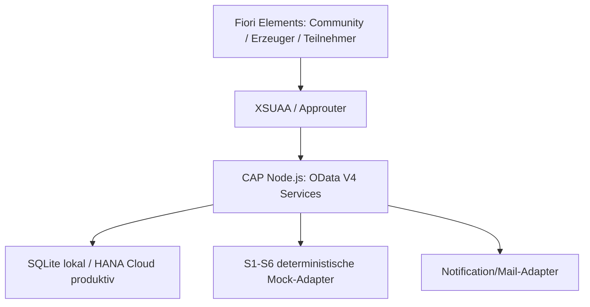

# 02 Gesamtarchitektur

Die Anwendung ist ein CAP-Node.js-Backend mit gemeinsamem CDS-Domänenmodell und mehreren Fiori-Elements-Oberflächen. Lokal wird SQLite verwendet, produktiv HANA Cloud/HDI.

Services:

- `CommunityManagementService`: Communities, Zuordnung und Aktivierung.
- `ProducerOnboardingService`: Anlagenstatus und Prüfpunkte.
- `ParticipantOnboardingService`: Antrag, E-Mail-Verifikation und Einreichung.
- `AnalyticsService`: Zeitreihen und Zahlungspositionen.
- `IntegrationService`: Messwert- und Prognoseaufnahme.

CRUD bleibt beim CAP Generic Provider. Fachliche Vorgänge sind gebundene CDS-Actions. Benutzeroberflächen verwenden Annotationen; nur der mehrphasige Teilnehmerfluss benötigt das generierte FPM-Grundgerüst.
