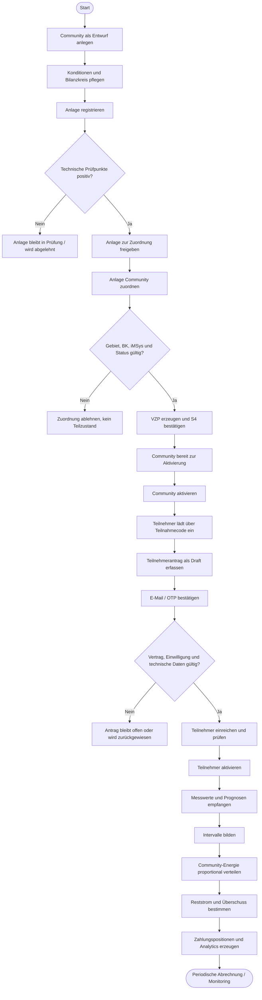
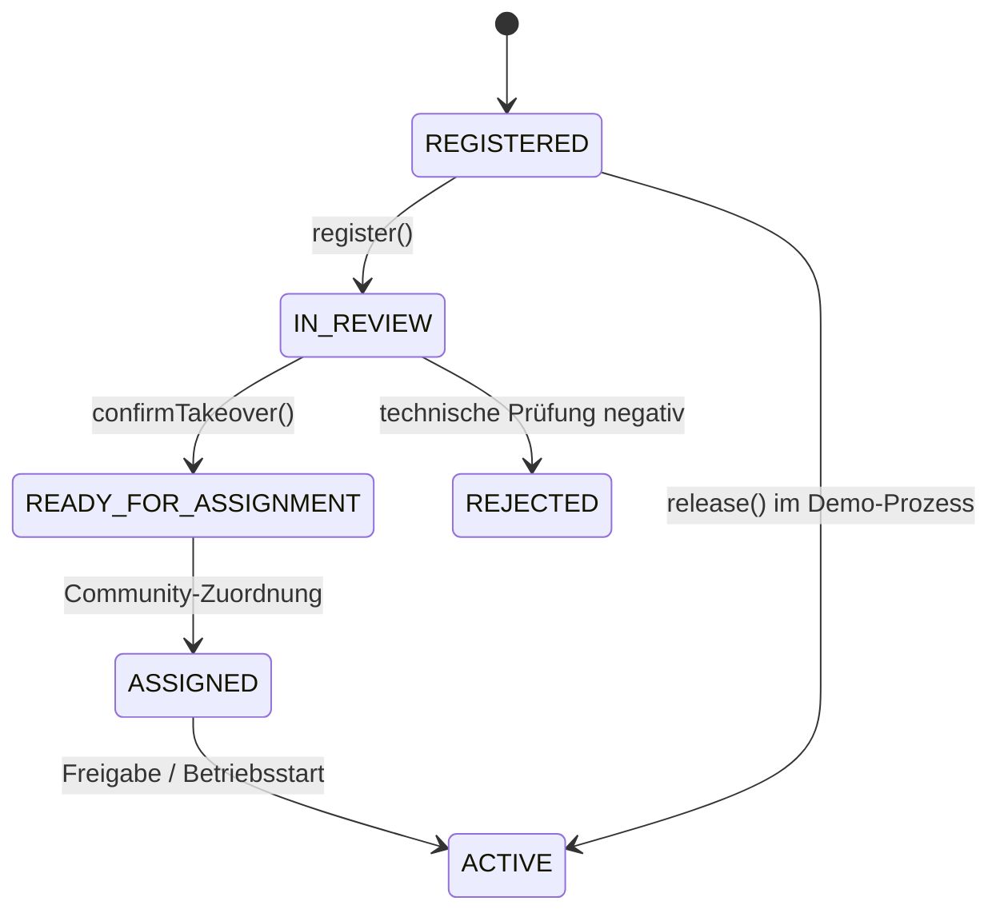
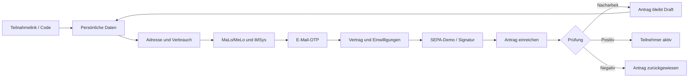

# Prozessfluss — Energy Sharing im Stadtteil

Dieses Dokument beschreibt den fachlichen End-to-End-Prozess der Anwendung: von der
Anlage einer Energy-Sharing-Community über das Erzeuger- und Teilnehmer-Onboarding
bis zur Intervallallokation und den daraus entstehenden Zahlungspositionen.

> **Lesart des Dokuments:** Der lokale Stand ist ein validierter MVP. Wo eine reale
> Marktpartner- oder BTP-Integration vorgesehen, aber noch nicht verfügbar ist,
> wird dies ausdrücklich als Zielbild oder Demo-Mock gekennzeichnet.

## 1. Beteiligte Rollen

| Rolle | Verantwortung |
|---|---|
| Community-Manager / Lieferant | Community anlegen, Konditionen pflegen, Anlagen und Teilnehmer verwalten, Community aktivieren |
| Anlagenbetreiber | Einspeiseanlage registrieren, technische Daten bestätigen, Zuordnung freigeben |
| Teilnehmer / Verbraucher | Teilnahme beantragen, Identität und E-Mail bestätigen, Vertrag und Einwilligungen bestätigen |
| Integrationsclient | Messwerte und Prognosen liefern, Integrationsstatus verarbeiten |
| Netzbetreiber / Marktpartner | Im Zielbild technische und marktbezogene Prüfungen sowie Zuordnungen bestätigen |
| Abrechnung / Zahlungsprozess | Im Zielbild Zahlungspositionen erzeugen und ausführen; im MVP nur modelliert |

## 2. Gesamtprozess



## 3. Prozessschritt 1 — Community anlegen

Der Community-Manager erfasst eine Community zunächst im Status `DRAFT`.
Mindestens folgende Informationen gehören zur Community:

- Name und Standort
- Ansprechpartner
- Bilanzierungsgebiet
- Bilanzkreis-ID
- Lieferant
- Preis- und Reststrommodell
- Gültigkeitsbeginn
- Allokationsregel `CONSUMPTION_PER_INTERVAL`

Die Community wird erst nach erfolgreicher Anlagenzuordnung in den Status
`READY_FOR_ACTIVATION` gesetzt. Erst danach ist die Aktivierung zulässig.

Technische Umsetzung:

- Entität: `neo.energy.Communities`
- Service: `CommunityManagementService`
- UI: `app/community-management`
- Draft-Unterstützung über OData V4 / Fiori Elements

## 4. Prozessschritt 2 — Erzeuger-Onboarding

Der Anlagenbetreiber registriert eine Anlage mit technischen und marktbezogenen
Daten:

- Betreiber und Kontakt
- Erzeugungsart und Leistung
- Gebäude-/Standort-ID
- MaLo-/MeLo- beziehungsweise Messstelleninformationen
- Bilanzierungsgebiet und Bilanzkreis
- iMSys-Status
- gewünschter Starttermin

Die Anlage durchläuft Prüfpunkte. Ein möglicher Statusfluss ist:



Technische Umsetzung:

- Entitäten: `Plants`, `PlantCheckpoints`
- Service: `ProducerOnboardingService`
- UI: `app/producer-portal`
- Lokale Demo-Actions: `register`, `confirmTakeover`, `release`

## 5. Prozessschritt 3 — Anlage einer Community zuordnen

Die Zuordnung ist der erste vollständig umgesetzte vertikale Fachprozess.

### Validierungen

`assignPlant` prüft:

1. Community und Anlage existieren.
2. Community befindet sich im Status `DRAFT`.
3. Anlage befindet sich im Status `READY_FOR_ASSIGNMENT`.
4. Anlage besitzt ein aktives iMSys.
5. Bilanzierungsgebiet stimmt überein.
6. Bilanzkreis stimmt überein.
7. Community besitzt noch keine Zuordnung dieses Prozessschritts.
8. Eine bereits bestehende identische Zuordnung wird idempotent behandelt.

Bei einer fachlichen Ablehnung wird kein unvollständiger Zustand gespeichert.
Bei Erfolg werden in einer CAP-Transaktion:

- `PlantAssignments` angelegt,
- eine deterministische VZP-ID erzeugt,
- die Anlage auf `ASSIGNED` gesetzt,
- die Community auf `READY_FOR_ACTIVATION` gesetzt,
- der Demo-S4-Status auf `ACKNOWLEDGED` gesetzt.

```mermaid
sequenceDiagram
    actor Manager as Community-Manager
    participant UI as Community Fiori App
    participant CAP as CommunityManagementService
    participant DB as CAP-Transaktion / SQLite oder HANA
    participant S4 as S4-/VZP-Adapter (Zielbild)

    Manager->>UI: Anlage auswählen und validFrom erfassen
    UI->>CAP: assignPlant(plantId, validFrom)
    CAP->>DB: Community und Anlage laden
    CAP->>CAP: Status, iMSys, Gebiet, BK prüfen
    alt Prüfung negativ
        CAP-->>UI: fachlicher Fehler
        UI-->>Manager: Zuordnung nicht möglich
    else Prüfung positiv
        CAP->>DB: Assignment + Statusänderungen schreiben
        CAP->>S4: VZP-/S4-Bestätigung (Zielbild; lokal Demo-Ack)
        S4-->>CAP: ACKNOWLEDGED
        CAP-->>UI: PlantAssignment mit vzpId
        UI-->>Manager: Community bereit zur Aktivierung
    end
```

## 6. Prozessschritt 4 — Community aktivieren

Die Community kann aktiviert werden, wenn mindestens eine gültige
Anlagenzuordnung vorhanden ist. `activateCommunity` prüft den Zustand erneut und
setzt die Community auf `ACTIVE`.

Ab diesem Status können Teilnehmer aufgenommen werden. Änderungen an der
fachlichen Konfiguration müssen im Zielbild über einen kontrollierten
Änderungsprozess erfolgen.

## 7. Prozessschritt 5 — Teilnehmer-Onboarding

Das Teilnehmer-Onboarding ist als Fiori Elements Flexible Programming Model
vorbereitet, weil es mehrere Schritte mit Status- und Validierungsübergängen
benötigt.

### Vorgesehener Ablauf



Im aktuellen MVP sind folgende Actions vorhanden:

- `sendVerificationCode()`
- `verifyEmail(code)`
- `submitApplication()`

Die vollständige fachliche Prozesskette mit SEPA, Signatur, allen
Identifikationsregeln und Resume-Verhalten ist noch offen.

## 8. Prozessschritt 6 — Messung und Intervallverarbeitung

Für jedes Community-Intervall werden Erzeugung und Verbrauch zusammengeführt.
Die vorgesehenen Eingangsdaten sind:

- `MeterReadings` für Verbrauch und Einspeisung
- `ForecastValues` für Prognosen
- Community- und Teilnehmerbezug
- Intervallbeginn und -ende
- 15-Minuten- oder Stundenauflösung

Die fachliche Berechnung verwendet:

```text
G = min(E, V)
R = max(0, V - E)
Ü = max(0, E - V)
Anteil_i = G × V_i / V
```

Dabei gilt:

- `E` = erzeugte Energie im Intervall
- `V` = Gesamtverbrauch im Intervall
- `G` = gemeinschaftlich nutzbare Energie
- `R` = Reststrombedarf
- `Ü` = Überschuss
- `V_i` = Verbrauch des Teilnehmers `i`

Bei `V = 0` wird keine Division durchgeführt; die gesamte Erzeugung gilt als
Überschuss.

Die getestete Kernfunktion liegt in
`srv/code/analytics-service/allocation.js`. Die vollständige Persistierung und
periodische Verarbeitung ist noch auszubauen.

## 9. Prozessschritt 7 — Zahlungspositionen und Analytics

Aus den Intervallwerten entstehen im Zielbild:

- gemeinschaftlich gelieferte Energiemenge,
- Reststrommenge,
- Überschussmenge,
- Produzentenvergütung,
- Serviceentgelt,
- Teilnehmerkosten,
- aggregierte Community-Kennzahlen.

Das Datenmodell enthält hierfür `ParticipantAllocations`, `PaymentPositions` und
`CommunityIntervals`. Eine produktive Billing- oder Payment-Ausführung findet im
aktuellen Projektstand nicht statt.

## 10. Integrationssicht S1–S6

| Schnittstelle | Prozessmoment | Aktueller Stand |
|---|---|---|
| S1 | Stammdaten und Anlagen-/Teilnehmerdaten | CDS-Modell und lokale Seed-Daten |
| S2 | Auftrag / Marktprozess | Action-/Adapter-Grenze vorbereitet |
| S3 | Ergebnis und Begründung | Status- und Prüfpunkte-Modell |
| S4 | VZP-/Formeländerung | Assignment mit Demo-Status `ACKNOWLEDGED` |
| S5 | Messung und Allokation | Messwertmodell und Allokationsfunktion |
| S6 | Bilanzkreis | Bilanzkreisfelder und Zuordnungsprüfung |

## 11. Status- und Fehlerprinzipien

- Fachliche Vorgänge werden als CDS-Actions modelliert.
- CRUD bleibt beim CAP Generic Provider.
- Pflichtfelder werden deklarativ und durch fachliche Actions abgesichert.
- Fehler werden vor dem Schreiben des fachlichen Ergebnisses zurückgegeben.
- Transaktionale Schritte dürfen keinen halbfertigen Zustand hinterlassen.
- Lokale Demo-Integrationen werden nicht als produktive Marktkommunikation
  ausgegeben.

## 12. Implementierungsstand

### Umgesetzt

- Community-Draft und Community-Verwaltung
- Anlagenmodell und Prüfpunkte
- atomare Anlagenzuordnung
- VZP-Erzeugung im Demo-Prozess
- Community-Aktivierung
- Teilnehmerantrag-Grundfluss
- Allokationskernfunktion
- lokale OData- und SQLite-Ausführung

### Noch offen

- vollständige Excel-Datenübernahme
- vollständige Teilnehmer-Onboarding-Oberfläche
- vollständige Allokationspersistierung und Abrechnung
- produktive S1–S6-Adapter
- echte E-Mail-, Signatur-, Billing- und Payment-Integrationen
- Browser-E2E-Tests und BTP-Deployment
