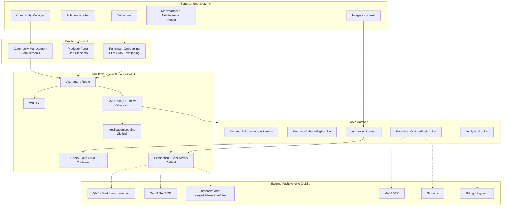
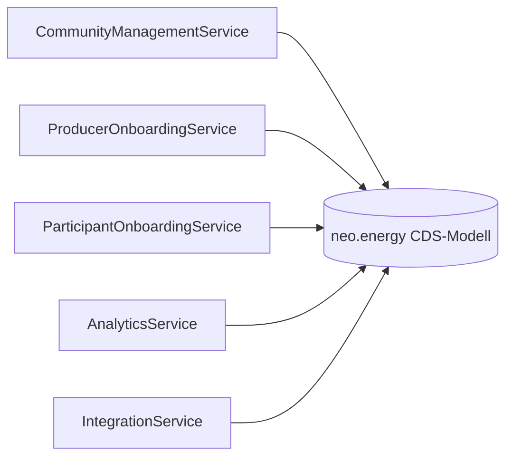
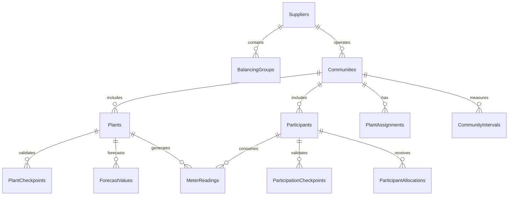
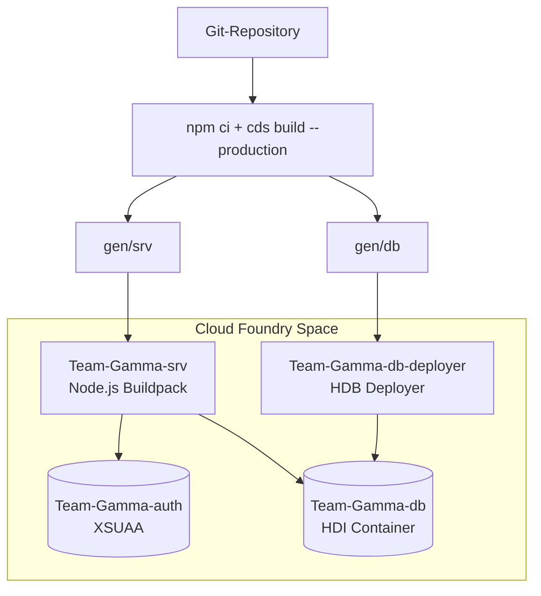
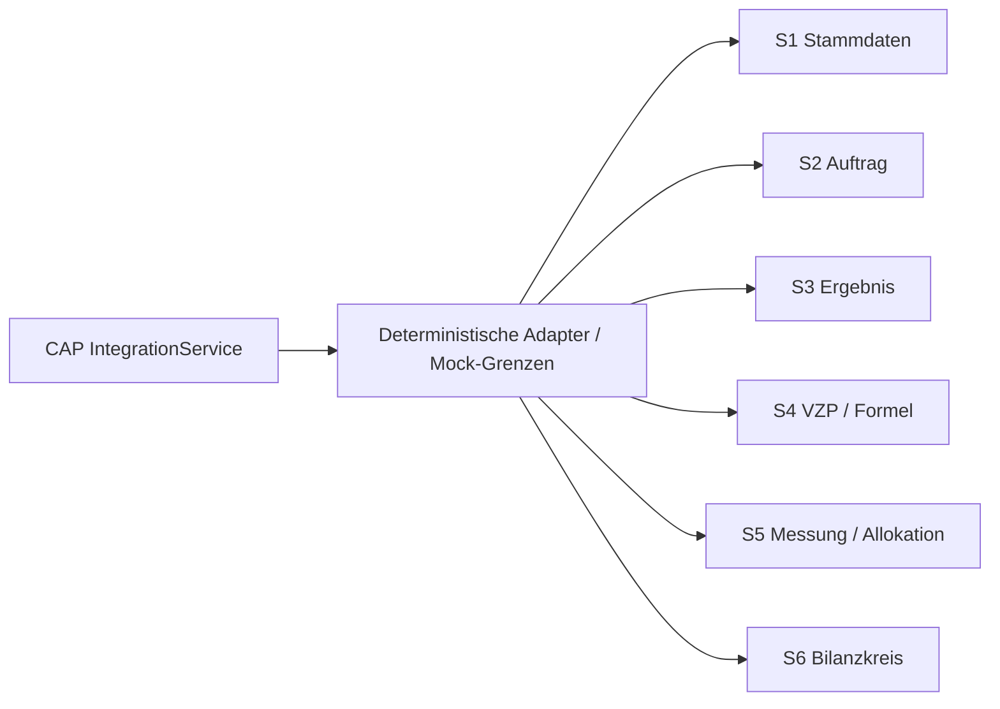

# Systemlandschaft — Energy Sharing im Stadtteil

Dieses Dokument beschreibt die fachliche, technische und deploymentbezogene
Landschaft der Anwendung. Es unterscheidet zwischen dem aktuell lokal
validierten MVP und dem vorgesehenen produktiven SAP-BTP-Zielbild.

## 1. Landschaft auf einen Blick



## 2. Frontend-Landschaft

Die Benutzeroberflächen sind Fiori-Elements-Anwendungen auf SAPUI5-Basis.

| Anwendung | Pfad | Floorplan | Backend-Service | Zweck |
|---|---|---|---|---|
| Community Management | `app/community-management` | List Report / Object Page | `CommunityManagementService` | Communities, Konditionen, Anlagen, Teilnehmer |
| Producer Portal | `app/producer-portal` | List Report / Object Page | `ProducerOnboardingService` | Anlagenregistrierung und Anlagenstatus |
| Participant Onboarding | `app/participant-onboarding` | Flexible Programming Model | `ParticipantOnboardingService` | mehrstufiger Teilnehmerantrag |

Gemeinsame Frontend-Eigenschaften:

- OData V4 als Datenprotokoll
- SAPUI5 Runtime
- Fiori Elements Templates und CDS-Annotations
- responsive Geräteunterstützung für Desktop, Tablet und Smartphone
- app-spezifische `manifest.json`, `ui5.yaml` und i18n-Dateien

Die dritte Anwendung verwendet eine gezielte UI5-Erweiterung für den geführten
Onboarding-Prozess. Sie ist keine vollständig frei entwickelte Freestyle-App.

## 3. Zugriff und Sicherheit

### Lokal

Im lokalen Demo-Betrieb stellt CAP eine Mock-Authentifizierung bereit. Für den
lokalen Smoke-Test wurde der Benutzer `alice` verwendet.

### Zielbild auf SAP BTP

XSUAA übernimmt die Authentifizierung und die Ausgabe von OAuth2-Tokens. Die
vorbereiteten Rollen sind:

| Rolle | Zweck |
|---|---|
| `Producer` | Anlagenbetreiber und Producer Portal |
| `Supplier` | Community- und Lieferantenverwaltung |
| `Participant` | Teilnehmerprozesse |
| `IntegrationClient` | technische Messwert- und Prognoseaufnahme |

Die fachliche Einschränkung einzelner Datensätze nach Benutzer, Community oder
Rolle muss noch durch vollständige `@restrict`-Regeln und produktive Token-Tests
ergänzt werden.

## 4. CAP-Service-Landschaft



### Services und Verantwortungen

| Service | HTTP-Pfad | Verantwortungsbereich |
|---|---|---|
| `CommunityManagementService` | `/service/CommunityManagementService` | Communities, Plant-Assignment, Aktivierung, Teilnehmerübersicht |
| `ProducerOnboardingService` | `/service/ProducerOnboardingService` | Anlagen und technische Prüfpunkte |
| `ParticipantOnboardingService` | `/service/ParticipantOnboardingService` | Applications, E-Mail-Verifikation, Einreichung |
| `AnalyticsService` | `/service/AnalyticsService` | Intervalle, Allokationen, Zahlungspositionen |
| `IntegrationService` | `/service/IntegrationService` | Messwerte und Prognosen |

Die Services verwenden Projektionen auf das zentrale CDS-Modell. Datenbanktabellen
werden nicht als unkontrollierte öffentliche API exponiert.

## 5. Gemeinsames Datenmodell



Zentrale Modellbereiche:

- `Suppliers`, `BalancingGroups`
- `Communities`
- `Plants`, `PlantCheckpoints`
- `Participants`, `ParticipationCheckpoints`
- `PlantAssignments`, `VirtualMeteringPointRelationships`
- `MeterReadings`, `ForecastValues`
- `CommunityIntervals`, `ParticipantAllocations`
- `PaymentPositions`
- `ParticipationApplications`

Die fachliche Quelle des Datenmodells ist `db/schema.cds`. Die Demo-Saatdaten
liegen in `db/data/`.

## 6. Persistenz und Laufzeitprofile

| Umgebung | Laufzeit | Persistenz | Zweck |
|---|---|---|---|
| Lokal | CAP Node.js / `cds watch` | SQLite beziehungsweise In-Memory-Demo | Entwicklung, Tests, Demo |
| CI / Build | CDS Build | generierte HANA- und Node-Artefakte | Compile- und Produktionsbuild |
| SAP BTP Zielbild | CAP Node.js auf Cloud Foundry | SAP HANA Cloud / HDI Container | produktiver Betrieb |

Die Eingabedateien für Konzept und Datasets liegen getrennt unter
`docs/sources/`. Sie werden nicht automatisch als produktive Datenbankquelle
geladen. Die überführten Demo-Daten liegen als CSV-Dateien unter `db/data/`.

## 7. Deployment-Landschaft



Vorbereitet sind:

- `mta.yaml`
- Node.js-Service-Modul
- HDB-Deployer-Modul
- HANA-HDI-Container-Ressource
- XSUAA-Ressource
- `xs-security.json`
- Produktionsbuild über `npm run build`

Ein tatsächliches Deployment in einen BTP-Space wurde nicht ausgeführt, weil
Organisation, Space, Entitlements und Zugangsdaten fehlen.

## 8. Integrationslandschaft



Im Zielbild werden die Adapter über BTP Destination Service und Connectivity an
externe Systeme angebunden. Die Anwendung legt keine URLs, Passwörter oder
Credentials im Quellcode ab.

| Zielsystem | Zielbildliche Verantwortung | Aktueller Projektstand |
|---|---|---|
| VNB / Netzbetreiber | technische und marktbezogene Prüfungen | lokale Status-/Prüfpunkte-Modelle |
| S/4HANA oder VZP-System | VZP und Zuordnung | lokale VZP-ID und Demo-Acknowledgement |
| Lumenaza / Plattform | Markt- und Community-Prozess | Adaptergrenze beschrieben, nicht produktiv angebunden |
| Mail / OTP | E-Mail-Bestätigung | Demo-Action ohne realen Versand |
| Signatur | Vertragsbestätigung | noch offen |
| Billing / Payment | Abrechnung und Zahlung | Zahlungspositionsmodell, keine Ausführung |

## 9. Repository-Landschaft

```text
Team-Gamma/
├── app/                         # drei Fiori-Elements-Anwendungen
├── db/                          # CDS-Domänenmodell und Seed-Daten
├── srv/                         # Service-Definitionen, Annotationen, Handler
│   ├── annotations/             # servicebezogene Backend-Annotations
│   └── code/                    # fachliche Implementierung
├── test/                        # Unit- und Integrationstests
├── docs/                        # Architektur, Prozess, Tests, Deployment
│   └── sources/                 # PDF- und Excel-Quellen
├── prompts/                     # fachliche Anforderungsquellen
├── mta.yaml                     # BTP-/Cloud-Foundry-Deployment
├── xs-security.json             # XSUAA-Rollen
├── package.json                 # Scripts und Abhängigkeiten
└── README.md                    # Einstieg und Schnellstart
```

## 10. Betriebs- und Qualitätsstatus

Erfolgreich validiert:

- `npm test`: vier Tests bestanden
- vollständige CDS-Modellprüfung
- EDMX-Kompilierung aller Services
- CAP-Produktionsbuild
- lokaler OData-Smoke-Test
- Anlagenzuordnung mit VZP-Erzeugung

Noch ausstehend:

- produktive BTP-Bindings
- vollständige `@restrict`-Regeln
- Browser-E2E-Tests
- vollständige externe Marktpartner-Integrationen
- vollständige Analytics- und Abrechnungsverarbeitung
